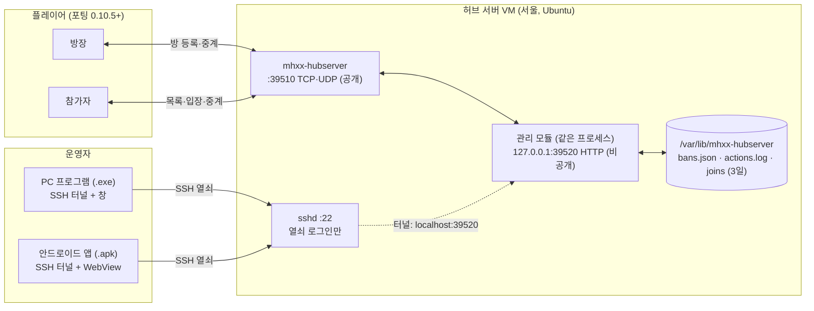
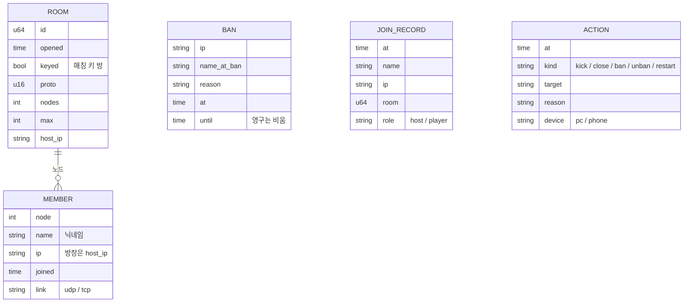
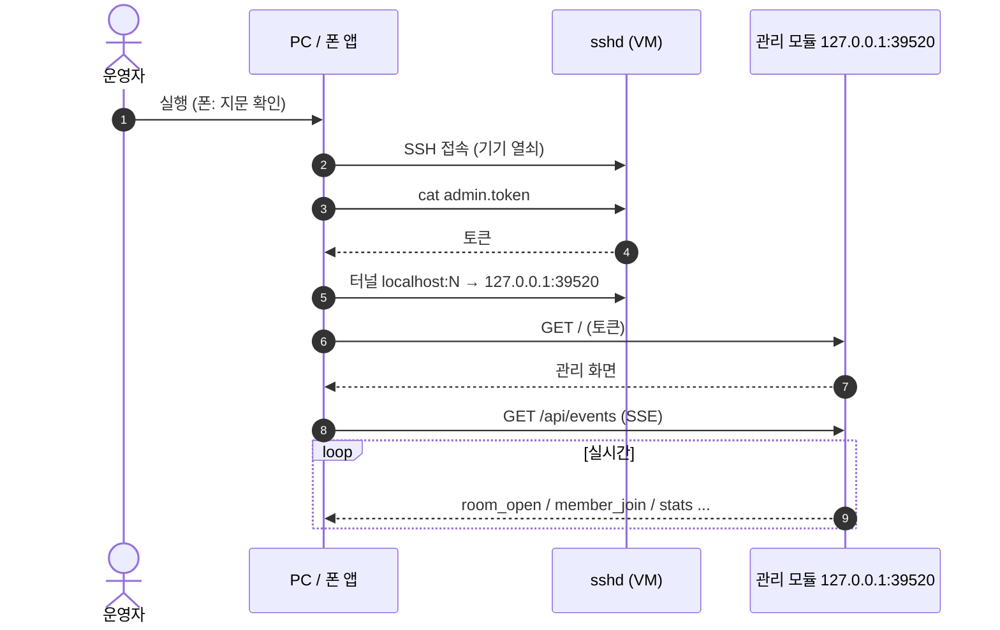
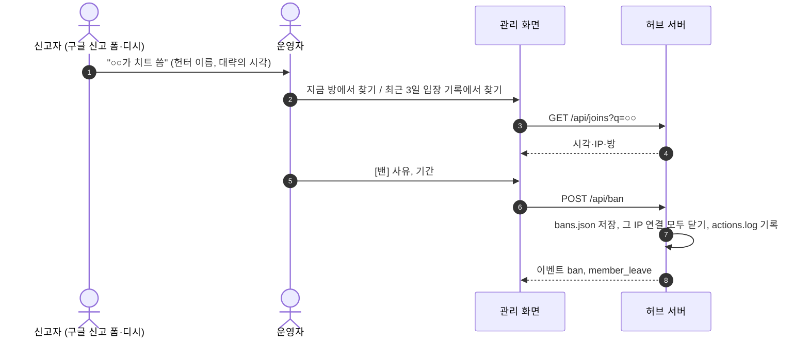
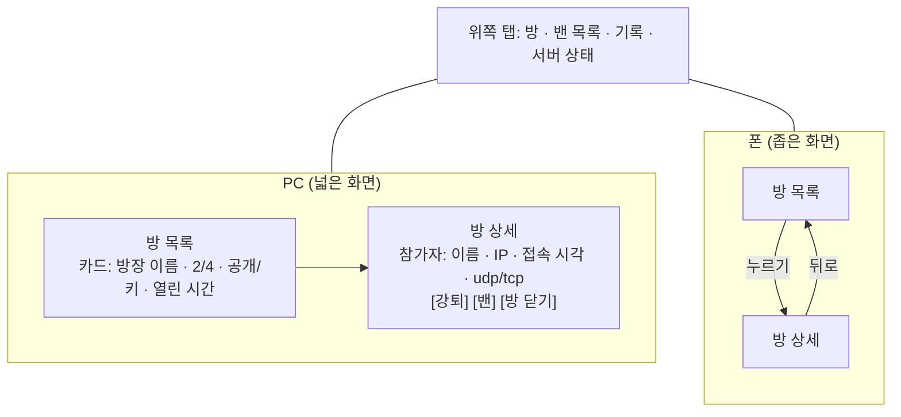

# 허브 서버 관리 앱 설계

> 상태: **1·2·5단계 구현, 서버에서 운영 중**(`server/admin.go`, `admin_store.go`, `admin/index.html`, 안드로이드 앱 `tools/hubadmin-android`). 0.10.16부터 IP 대신 **포트 ID**와 **섞은 주소**(10장). 3·4단계는 구현 전. 포팅 릴리즈와 별개인 운영 도구입니다(사용자는 아무것도 바꿀 필요 없음).
> 관련: [허브 서버 운영](hub-server.md), `server/` (허브 서버 코드), `runtime/net/ldn.c` (포팅 쪽 통신)

## 1. 목적

갤집(공개 집회소)에서 신고가 들어왔을 때 운영자가 **PC나 폰으로 바로** 방과 사람을 보고 **강퇴·밴**할 수 있게 한다.

- 치트를 자동으로 **감지하지 않는다.** 신고 → 운영자가 확인 → 조치.
- 포팅은 고치지 않는다. 허브 서버가 이미 아는 정보만 쓴다.

### 하지 않는 것

- 게임 내용·채팅 감시 (서버는 링크 내용을 읽지 않는 구조를 유지)
- 자동 치트 감지, 설치 ID (포팅 수정이 필요: 나중에 필요하면 별도 설계)
- 인터넷에 공개된 관리자 로그인 페이지
- 아이폰 앱

## 2. 결정 사항

| 항목 | 결정 |
|---|---|
| 코드 위치 | 공개 저장소 `server/` (관리 화면 포함). **밴 목록·기록 파일은 서버에만**, 저장소에 올리지 않음 |
| 구조 | 알맹이: 허브 서버 안의 웹 관리 화면. 껍데기: PC 프로그램, 안드로이드 앱 |
| 접속 | 관리 화면은 서버의 `127.0.0.1`에만 열림. 앱이 **SSH 열쇠로 터널**을 열어 접속 |
| 기기별 열쇠 | PC 열쇠, 폰 열쇠 따로 (`authorized_keys`에 각각). 폰은 지문·화면 잠금으로 앱 잠금 |
| 화면 | PC·폰 크기에 맞춰 배치, 실시간 갱신(새로고침 없음), 애니메이션, 런처와 같은 어두운 테마 |
| 기록 | 최근 **3일** 입장 기록(시각·이름·IP), 관리 조치 기록. 3일 지나면 자동 삭제 |
| 밴 | IP 기준, 1일 / 7일 / 영구, 사유 |
| 만드는 순서 | 웹 관리 화면 → PC 프로그램 → 안드로이드 앱 |

## 3. 전체 구조

- 관리 모듈은 허브 서버와 **같은 프로세스**: 방·연결 상태를 직접 읽고, 강퇴·밴을 바로 적용한다(별도 프로세스와 IPC 불필요).
- 방화벽은 지금 그대로(22, 39510만). 39520은 `127.0.0.1`에만 열리므로 방화벽을 건드리지 않는다.

## 4. 서버가 이미 아는 정보 (코드 기준)

| 정보 | 출처 (`server/server.go`) |
|---|---|
| 방 id, 열린 시각, 방장 IP, 통신 규칙 번호 | `hub{id, created, ip, proto}` |
| 공개방 / 키 방 | `hub.room` (매칭 키의 SHA-256 앞 16바이트. **키 내용은 서버도 모름**) |
| 인원, 최대 인원 | `hub.info` NetworkInfo `0x67`(node count), `0x66`(node max) |
| 참가자 이름 | NetworkInfo 노드 배열 `0x68`부터 `0x40`바이트씩, 이름은 노드의 `0x0C`, 32바이트 (`ldn.c` `NODE_NAME`) |
| 참가자 IP | `join()`의 연결 주소 (pending → pair) |
| 직접 UDP / TCP 중계 | `pair.addr[0/1]`이 잡혔는지 |
| IP별 연결 수 | `ipState` |

노드 이름: 0.10.15부터 **게임 속 헌터 이름**(한글 패치의 글자를 한글로 되돌린 UTF-8, `ldn.c` `node_name`). 세이브를 아직 안 불러왔으면 포팅 설정의 닉네임. 0.10.14 이하 포팅은 닉네임(대개 "Hunter"). 이름은 사용자가 바꿀 수 있으므로 **조치는 이름이 아니라 IP로** 한다.

## 5. 데이터 모델

- `ROOM`, `MEMBER`: 메모리에만 (실시간).
- `BAN`: `bans.json` (서버 재시작 후에도 유지).
- `JOIN_RECORD`: 메모리 + 하루 단위 파일, **3일 지나면 삭제**.
- `ACTION`: `actions.log` (운영 근거. 보관 기간은 1년, 그 뒤 삭제).
- 저장 위치: systemd `StateDirectory=mhxx-hubserver` → `/var/lib/mhxx-hubserver` (`DynamicUser=yes`와 같이 씀).

## 6. 관리 API (127.0.0.1:39520)

| 메서드 | 경로 | 하는 일 |
|---|---|---|
| GET | `/` | 관리 화면 (HTML/JS/CSS, 서버 실행 파일에 `go:embed`) |
| GET | `/api/state` | 방·참가자·서버 상태 한 번에 |
| GET | `/api/events` | 실시간 변경 (Server-Sent Events): `room_open`, `room_close`, `member_join`, `member_leave`, `ban`, `stats` |
| POST | `/api/kick` | `{ip}`: 그 IP의 연결을 끊음 (다시 들어올 수 있음) |
| POST | `/api/close` | `{room}`: 방장 연결을 끊어 방을 내림 |
| POST | `/api/ban` | `{ip, reason, days}` (`days=0`이면 영구): 밴 + 지금 연결도 끊음 |
| POST | `/api/unban` | `{ip}` |
| GET | `/api/bans` | 밴 목록 |
| GET | `/api/joins?q=` | 최근 3일 입장 기록 (이름이나 IP로 찾기) |
| GET | `/api/actions` | 관리 조치 기록 |

- **2중 잠금**: 터널(SSH 열쇠) + 요청 헤더의 관리 토큰. 토큰은 서버의 `/var/lib/mhxx-hubserver/admin.token`(처음 실행 때 무작위 생성, 600 권한). 앱은 SSH로 이 파일을 읽어 온다.
- POST는 같은 출처(`Origin`)만, 토큰 없으면 403.
- 허브 서버 **재시작**은 API가 아니라 앱이 SSH 명령(`systemctl restart mhxx-hubserver`)으로 한다(자기 자신을 재시작하는 문제를 피함).

### 밴 적용 위치

- `admit(ip)`: 밴된 IP의 새 연결은 바로 닫는다 → LIST·HOST·JOIN 모두 막힘. 게임에는 "연결 실패"로 보인다.
- 밴하는 순간: 그 IP의 방(HOST)과 중계(pair) 연결을 모두 닫는다.
- 만료된 밴은 `janitor()`가 정리.

## 7. 서버 상태 수집

| 항목 | 출처 |
|---|---|
| CPU, 메모리, 스왑 | `/proc/stat`, `/proc/meminfo` (10초마다) |
| 이번 달 트래픽 | `/proc/net/dev` 송신 바이트를 하루마다 `StateDirectory`에 누적 (VM 재부팅에도 이어짐). vnstat이 있으면 그 값과 비교 표시 |
| 허브 서버 켜진 시간, 버전 | 프로세스 시작 시각, 빌드 커밋 |
| 연결 수, 방 수 | 서버 상태 |

트래픽 한도(iwinv vgna_1_n 월 620GB) 대비 % 표시.

## 8. 앱 동작

### PC 프로그램

- Go 하나로: SSH(`golang.org/x/crypto/ssh`) + 창(`webview`, Windows는 WebView2. 윈도우 10/11에 기본 포함).
- 설정: 서버 주소(`mhxx-kr.duckdns.org`), 열쇠 파일 경로(기본 `F:\MHXX_port\server\mhxx-hub-key`). 한글이 있는 경로도 읽을 수 있게 Go의 파일 API로 직접 연다.
- 메뉴: 새로고침, 허브 서버 재시작(SSH 명령), 서버 업데이트(설치 스크립트 다시 실행)
- 연결이 끊기면 자동 재연결, 화면 위에 "연결 끊김" 띠.

### 안드로이드 앱

- Kotlin + WebView + SSH 라이브러리(sshj 등).
- 처음 실행: 폰에서 ed25519 열쇠 생성 → 공개 열쇠 표시(복사 버튼) → 운영자가 PC 앱으로 서버 `authorized_keys`에 추가.
- 개인 열쇠는 안드로이드 Keystore로 감싼 키로 암호화해 앱 저장소에. 앱 열 때 BiometricPrompt(지문·화면 잠금).
- 폰을 잃어버리면: 서버에서 그 폰 열쇠 한 줄만 지운다.

## 9. 화면

- **방**: 실시간. 들어오고 나갈 때 부드럽게 나타나고 사라짐. 접속 중 점 표시.
- **밴 목록**: IP, 당시 이름, 사유, 남은 기간, [해제].
- **기록**: 입장 기록(검색), 관리 조치 기록.
- **서버 상태**: CPU·메모리 작은 그래프, 이번 달 트래픽 막대(620GB 대비), 켜진 시간, [재시작].
- 강퇴·밴·방 닫기·재시작은 **확인 창**, 끝나면 토스트 알림.
- 테마: 런처와 같은 어두운 색, 한글 글꼴.

## 10. 개인정보

0.10.16부터 (0.10.15까지 IP를 그대로 보여 주고 기록했던 것을 바꿈. 디시 지적, 2026-11-26):

- **동의:** 포트는 플레이어가 동의하기 전에는 허브 서버에 아무 요청도 보내지 않는다(`[Multiplayer] HubConsent`, 런처가 처음 한 번 묻고, F1 → 네트워크에서 바꿈). 동의 없이 허브를 쓰려 하면 "동의하지 않아 허브 서버를 쓰지 않습니다" 알림(한 번).
- **포트 ID:** 포트가 처음 허브 서버를 쓸 때 무작위 16바이트를 만들어 설정 파일 옆 `hub_id`에 둔다. 요청 머리에 실어 보내고(서버 프로토콜 2), 서버는 그 SHA-256의 40비트를 `ABCD-EFGH`로만 보여 주고 기록한다(원래 값은 어디에도 안 남김). 서버 프로토콜 1(0.10.15 이하)은 `errVersion`: 업데이트해야 허브를 쓸 수 있다.
- **IP:** 서버는 연결 중에만 메모리에 두고(연결·요청 수 제한, 강퇴), **파일과 관리 화면에는 쓰지 않는다.** 대신 `ip.key`(서버만 아는 비밀)로 HMAC-SHA256한 12자리(`net`)를 남긴다: 같은 주소인지만 알 수 있고 되돌릴 수 없다.
- **밴:** 포트 ID로. "같은 인터넷 주소도 막기"(기본 켬)를 고르면 `net`도 막아서, 포트 ID를 새로 만들어 돌아오는 것도 막는다. 같은 공유기·모바일 데이터의 다른 사람도 막힐 수 있다.
- **예전 파일:** 서버가 켜질 때 `bans.json`, `joins-*.jsonl`, `actions.log`의 IP를 `net`으로 바꿔 다시 쓴다(테스트 `TestStoreForgetsAddresses`).
- 관리자에게 보이는 것: 헌터 이름, 포트 ID, 방, 시각, 연결 방식. 다른 플레이어에게는 아무것도 안 보인다.

## 11. 단계와 확인

| 단계 | 내용 | 확인 |
|---|---|---|
| 1 | 관리 모듈: 상태 읽기(방·참가자 이름·IP), `/api/state`, `/api/events`, 화면 | 친구와 방을 열고 이름·인원·IP·udp/tcp가 맞게 보임. `server_test.go`에 가짜 방으로 테스트 |
| 2 | 강퇴·방 닫기·밴·해제, `bans.json`, `actions.log`, 입장 기록 3일 | 테스트 계정 IP로 밴 → 목록·입장 모두 막힘, 서버 재시작 후에도 유지, 해제 후 다시 됨 |
| 3 | 서버 상태(CPU·메모리·트래픽), 설치 스크립트에 `StateDirectory` | 재부팅 후 트래픽 누적 유지 |
| 4 | PC 프로그램 | 더블클릭 → 10초 안에 관리 화면, 연결 끊겼다 다시 붙음 |
| 5 | 안드로이드 앱 | 폰 열쇠 등록, 지문 잠금, 학교에서 데이터로 밴 처리 |

## 12. 열린 문제

- 노드 이름 인코딩과, 닉네임이 게임 속 헌터 이름과 같은지 (실제 방에서 확인)
- 통신사 모바일 IP는 여러 사람이 같은 IP를 쓸 수 있음(CGNAT): 영구 IP 밴은 신중하게. 화면에 "모바일 IP일 수 있음" 경고를 띄울지
- 같은 공유기의 가족·친구가 같이 막히는 문제: 밴 사유에 메모하고 짧은 기간부터
- 밴 사유를 게임에 보여 주려면 포팅 수정(새 오류 코드 + 메시지)이 필요: 필요해지면 별도 버전
